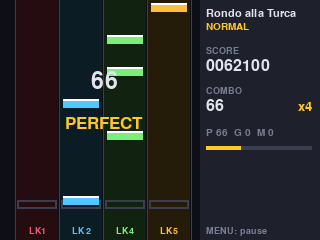

# LightBeat

Rhythm game a 4 corsie per il GameShell. Le note scendono lungo le corsie e
vanno premute quando toccano la linea in basso.



## Comandi

| Corsia | Lightkey | Frecce   | Tasti A/B/X/Y |
|--------|----------|----------|---------------|
| 1      | LK1      | Sinistra | Y             |
| 2      | LK2      | Giù      | B             |
| 3      | LK4      | Su       | X             |
| 4      | LK5      | Destra   | A             |

Il tasto centrale della Lightkey (LK3) è uno SHIFT hardware, quindi non viene
usato. MENU mette in pausa. Nei menu, A conferma e B torna indietro, secondo
il layout dei tasti scelto nelle impostazioni del GameShell.

## Punteggio

- **PERFECT** (±55 ms) vale 300 punti, **GOOD** (±115 ms) vale 100.
- Il moltiplicatore sale di 1 ogni 10 note di combo, fino a x4.
- Voti: S ≥ 95%, A ≥ 90%, B ≥ 80%, C ≥ 70%. Le note mancate azzerano la combo.
- Sotto ogni GOOD compare *early* o *late*. Se escono quasi sempre *late*,
  alza l'**Audio offset** in Options; se escono quasi sempre *early*, abbassalo.

I record vengono salvati in `scores.json` e le opzioni in `settings.json`,
nella cartella del gioco.

## Brani

Sono tutti arrangiamenti chiptune nostri di composizioni di pubblico dominio.

| Brano | Compositore | Anno |
|-------|-------------|------|
| Rondo alla Turca | W. A. Mozart (1756–1791) | 1783 |
| The Entertainer | Scott Joplin (1868–1917) | 1902 |
| Galop Infernal (Can-can) | J. Offenbach (1819–1880) | 1858 |

## Aggiungere un brano

1. In `tools/songs.py` scrivi melodia e accordi, seguendo gli esempi già
   presenti. La notazione è `Nota+Ottava.durata`, con la durata in sedicesimi:
   per esempio `C#5.2` è un ottavo e `r.4` una pausa da un quarto.
2. Genera audio e note da suonare:
   ```bash
   python3 Games/LightBeat/tools/make_songs.py
   ```
   Servono numpy e ffmpeg con libvorbis. Lo script crea in `src/songs/` il file
   `.ogg` e il `.json` con le note per Easy, Normal e Hard, ricavate dalla
   melodia.
3. Controlla che tutto funzioni con l'autoplay headless, che gioca ogni
   livello e salva gli screenshot:
   ```bash
   cd Games/LightBeat/src && SDL_VIDEODRIVER=dummy SDL_AUDIODRIVER=dummy LIGHTBEAT_TEST=/tmp/lb python3 main.py
   ```
4. Lancia `python3 scripts/build.py` dalla radice della repo.

Puoi anche giocare sul PC con `python3 main.py` dalla cartella `src/`.
